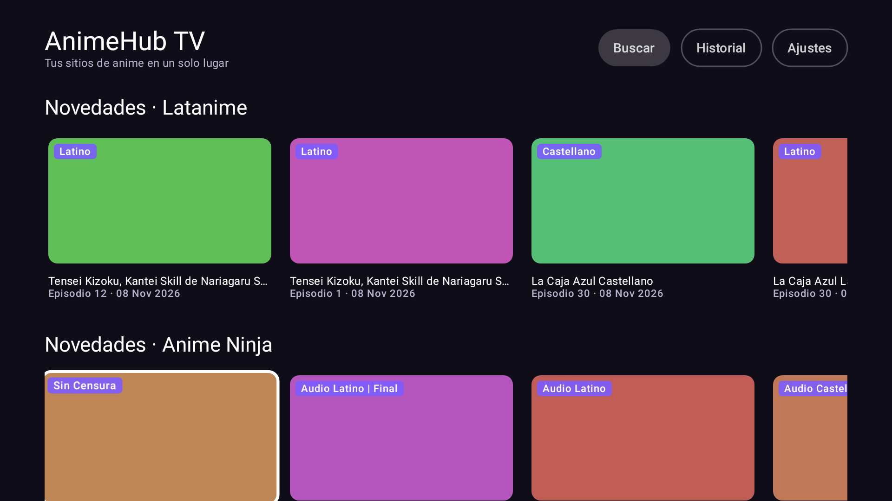

# AnimeHub TV

App para Android TV / Google TV que reúne varios sitios de anime en una interfaz nativa pensada para el control remoto y la voz.
**Uso personal:** se instala a mano; no se publica en Google Play ni se redistribuye.

## Estado

| Fase | Estado |
|---|---|
| 0 · Análisis de sitios | Latanime y Anime Ninja analizados; AnimeFLV y JKAnime pendientes ([resumen](docs/fase0-resumen.md)) |
| 1 · Esqueleto (Inicio, navegación con el control, Ajustes, configuración remota, Room, APK en GitHub Actions) | ✅ |
| 2 · Primer proveedor: Anime Ninja (novedades, búsqueda con portadas, ficha y episodios) | ✅ |
| 3 · Filtros dinámicos + búsqueda por voz (+ proveedor de Latanime) | ✅ |
| 4 · Servidores + reproductor WebView + historial con minuto | Siguiente |

## Requisitos

- Android Studio reciente (con soporte para AGP 9.5) o solo la línea de comandos con JDK 17+.
- SDK de Android con la plataforma 37 (Gradle la descarga sola si aceptaste las licencias).
- El dispositivo necesita Android 6.0 (API 23) o superior.

## Compilar

```bash
./gradlew testDebugUnitTest   # tests: parsers con los HTML de fixtures + navegación con el D-pad (Robolectric)
./gradlew testDebugUnitTest -Pcapturas   # además guarda capturas de pantalla en app/build/capturas
./gradlew testDebugUnitTest -Psalud --tests '*SaludSitiosTest*'   # "salud de sitios": prueba EN VIVO cada sitio (búsqueda de "one piece")
./gradlew assembleDebug       # APK de depuración → app/build/outputs/apk/debug/
./gradlew assembleRelease     # APK de release   → app/build/outputs/apk/release/
```

### APK desde GitHub Actions

Cada push compila el APK y lo deja en la pestaña **Actions** → la ejecución → **Artifacts** (`AnimeHubTV-<versión>`).
Al crear un tag `v1.2.3` (`git tag v1.2.3 && git push origin v1.2.3`) además se publica en **Releases**.

## Firma con tu propio keystore

Sin keystore, GitHub firma cada APK con una clave temporal distinta, y Android **no deja instalar una versión encima de otra** con firma distinta. Para poder actualizar sin desinstalar:

1. Crea el keystore una sola vez (guárdalo en un lugar seguro, **no** lo subas al repo):
   ```bash
   keytool -genkeypair -v -keystore animehub.jks -alias animehub \
           -keyalg RSA -keysize 4096 -validity 10000
   ```
   Te pedirá una contraseña y unos datos (nombre, país…; puedes poner cualquier cosa).
2. Conviértelo a texto Base64:
   ```bash
   base64 -w0 animehub.jks > animehub.jks.b64      # Linux
   base64 -i animehub.jks -o animehub.jks.b64      # macOS
   ```
   En Windows (PowerShell): `[Convert]::ToBase64String([IO.File]::ReadAllBytes("animehub.jks")) > animehub.jks.b64`
3. En GitHub: **Settings → Secrets and variables → Actions → New repository secret**, crea:

   | Secret | Valor |
   |---|---|
   | `ANDROID_KEYSTORE_BASE64` | el contenido de `animehub.jks.b64` |
   | `ANDROID_KEYSTORE_PASSWORD` | la contraseña del keystore |
   | `ANDROID_KEY_ALIAS` | `animehub` |
   | `ANDROID_KEY_PASSWORD` | la contraseña de la clave (la misma si no pusiste otra) |

Para firmar en tu PC, crea `keystore.properties` en la raíz (está en `.gitignore`):
```properties
storeFile=/ruta/a/animehub.jks
storePassword=…
keyAlias=animehub
keyPassword=…
```

## Instalar en la TV

**Con Downloader (sin cables):**
1. En la TV: Ajustes → Preferencias del dispositivo → Seguridad → permitir "Fuentes desconocidas" para *Downloader*.
2. Instala *Downloader* desde la tienda de la TV.
3. Abre en Downloader el enlace directo al APK (por ejemplo, el de la Release en GitHub) e instálalo.

**Con ADB (desde la PC, misma red Wi-Fi):**
1. En la TV: Ajustes → Preferencias del dispositivo → Información → pulsa 7 veces "Compilación" para activar el modo desarrollador; luego activa "Depuración por red/USB".
2. Busca la IP de la TV (Ajustes → Red).
3. En la PC:
   ```bash
   adb connect 192.168.1.50:5555
   adb install -r AnimeHubTV-0.1.0.apk
   ```

La app aparece en la fila de apps de la TV con su banner.

## Capturas (TV 1080p simulada)

| Inicio | Ajustes (elemento enfocado) | Confirmación al salir |
|---|---|---|
|  |  |  |

| Novedades | Búsqueda (cuadrícula de portadas) | Ficha del anime |
|---|---|---|
|  |  |  |

| Búsqueda por voz | Panel de filtros | Filtrado por género y año |
|---|---|---|
|  |  |  |

Se generan en las pruebas de navegación, que recorren la app solo con flechas, OK y Atrás. En las pruebas no hay red, así que las portadas aparecen como bloques de color; en la TV se ven las imágenes reales de cada sitio.

## Búsqueda, filtros y voz

- **Voz**: en Búsqueda el botón 🎤 tiene el foco al entrar; lo dictado (español latino, `es-419`) se escribe en el campo y se busca al instante. En Inicio, el botón "🎤 Voz" abre el dictado directamente. Si la TV no tiene reconocimiento de voz, los botones no aparecen.
- **Sitios**: "Todos los sitios" busca en paralelo (15 s máximo por sitio) o elige uno solo con su chip.
- **Filtros** (botón "Filtros"): con un sitio elegido se ven **sus filtros reales**, leídos de su web. En "Todos los sitios" solo los comunes (género, año, tipo, estado), traducidos al parámetro de cada sitio; si un sitio no puede aplicar un filtro se omite con un aviso.
- **Accesos rápidos**: "Emisión de esta temporada" y "Estrenos del año" aparecen solo si el sitio los permite (hoy, Latanime).
- La búsqueda por texto de **Latanime** está protegida por Cloudflare: por ahora muestra un aviso; su directorio con filtros sí funciona.

## Configuración remota (cuando un sitio cambia)

Los dominios, rutas, selectores CSS y filtros de cada sitio están en [`config/sites.json`](config/sites.json). La app:
1. al abrir, usa la copia guardada (o la incluida en el APK si no hay otra);
2. descarga la versión publicada desde la URL de Ajustes (por defecto `https://raw.githubusercontent.com/Yeikoromeo2/Anime-proyect-/main/config/sites.json`);
3. si la descarga falla, sigue con la que tenía.

Para corregir un sitio sin reinstalar: edita `config/sites.json`, **sube el número de `version`**, haz push a `main` y en la TV pulsa **Ajustes → Actualizar configuración**.

> Si el repositorio es **privado**, la URL `raw.githubusercontent.com` no funcionará desde la TV. En ese caso publica el JSON en un sitio público (por ejemplo un Gist público) y pon esa URL en Ajustes.

Cada dominio se puede corregir también a mano en **Ajustes → Sitios → (sitio) → Editar dominio**.

## Agregar un sitio nuevo

1. **Analizarlo** (como en la Fase 0): crea `docs/sites/<sitio>.md` con dominio, protección, búsqueda, filtros, selectores, detalle y servidores, y guarda páginas de ejemplo en `app/src/test/resources/fixtures/<sitio>/`.
2. **Configurarlo**: añade una entrada en `config/sites.json` (`id`, `name`, `baseUrl`, selectores, filtros) con `"status": "pendiente"` mientras no tenga proveedor.
3. **Proveedor**: si el sitio usa un motor ya soportado (por ejemplo WordPress con el tema DooPlay, como Anime Ninja), basta con poner `"engine": "dooplay"` y sus selectores en la configuración. Si no, crea `app/src/main/java/com/animehub/tv/providers/<motor>/` implementando `SiteProvider` (solo la lógica que no quepa en selectores) y regístralo en `ProviderRegistry`.
4. **Tests**: añade tests del proveedor contra los fixtures y cambia el estado a `"ok"`.

## Estructura

```
app/src/main/java/com/animehub/tv/
 ├─ ui/          Compose for TV: inicio, búsqueda, historial, ajustes, componentes
 ├─ domain/      modelos (AnimeCard, Episode, VideoServer, FilterGroup, WatchProgress…)
 ├─ data/
 │   ├─ db/      Room: favoritos, progreso, historial de búsquedas
 │   ├─ config/  configuración remota (descarga, caché, validación)
 │   ├─ settings/ DataStore (ajustes)
 │   ├─ net/     OkHttp, User-Agent, reintentos, cookies compartidas, detección de Cloudflare
 │   └─ log/     registro de los últimos 50 errores
 ├─ providers/   un proveedor por sitio (interfaz SiteProvider)
 └─ util/        normalización de portadas, formatos
config/sites.json  configuración publicada (también se incluye en el APK)
docs/              análisis de cada sitio
```
