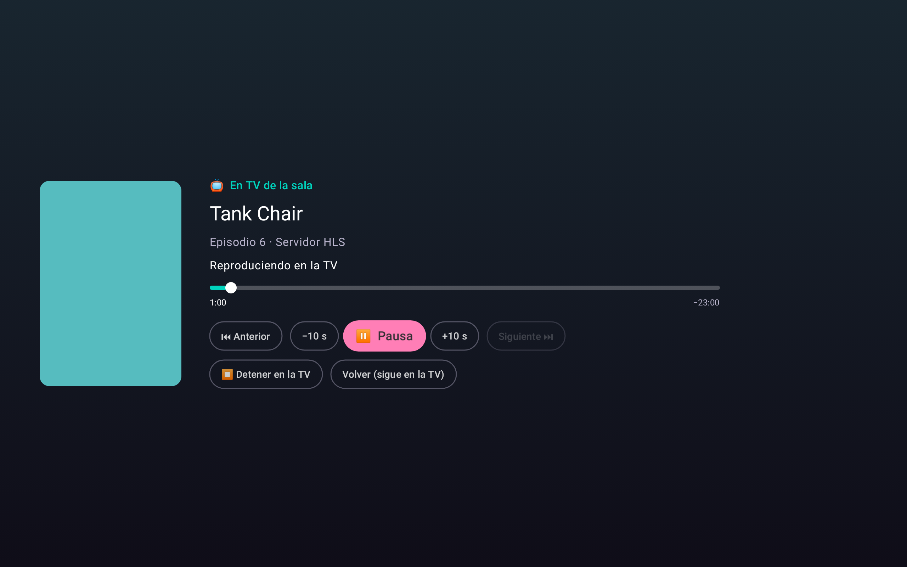
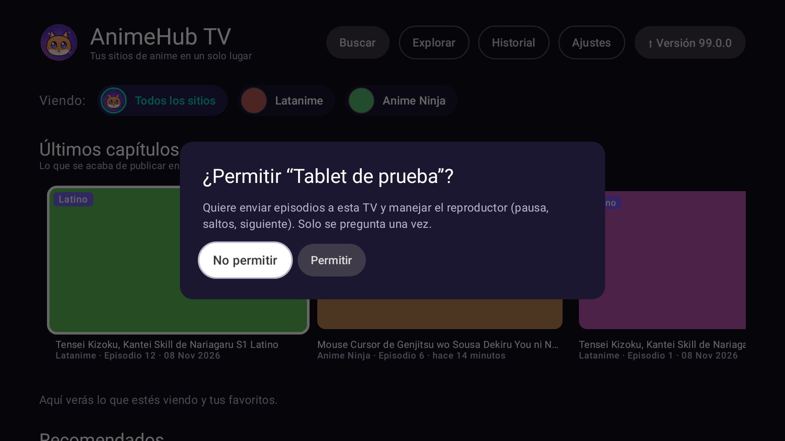

# Enviar a la TV desde la tablet (AnimeHub, Chromecast, DLNA)

Estado: **desarrollado en la 0.9.0**: "Enviar a mi TV", Chromecast y DLNA. Más abajo, el análisis original con las ventajas y límites de cada opción.

## Cómo se usa

1. **En la TV:** abre AnimeHub (solo hace falta en las TV con AnimeHub; Chromecast y DLNA no la necesitan).
2. **En la tablet:** abre la ficha de un anime. Si hay destinos en la red, aparece el botón **"📺 Ver en: …"**; al pulsarlo, un popup con solo los nombres:
   - **📱 Este dispositivo**;
   - **📺 TV con AnimeHub**;
   - **📡 Chromecast**;
   - **🖥 TV DLNA** (Samsung, LG…).
3. **Elige el destino** y luego el episodio. En la tablet queda el control remoto: pausa, ±10 s, anterior, siguiente, detener y el minuto en que va.
4. **La primera vez**, una TV con AnimeHub pregunta **"¿Permitir…?"**. Se acepta con el control y no vuelve a preguntar. En **Ajustes → Enviar a la TV** de la TV se pueden olvidar los dispositivos permitidos.

| Control remoto (TV con AnimeHub) | Permiso en la TV | TV DLNA |
|---|---|---|
|  |  |  |

## Cómo funciona

- **TV con AnimeHub:**
  - mientras la app está abierta, la TV escucha en la red de casa (`remote/MiniHttpServer.kt`, `remote/TvReceiver.kt`) y se anuncia por NSD como `_animehub._tcp`;
  - la tablet le manda el episodio (`/play`), las órdenes (`/command`) y pregunta el estado (`/status`);
  - la TV hace todo como si lo hubieras elegido en ella: servidor, bloqueo de anuncios, minuto guardado y siguiente episodio.
- **Chromecast y DLNA:**
  - la tablet busca el **video directo** del episodio, como el reproductor nativo;
  - lo publica con un **intermediario** (`stream/StreamProxy.kt`), que pide el video al servidor con sus cabeceras (`Referer`, `Origin`) y reescribe las listas HLS para que los trozos también pasen por la tablet;
  - **Chromecast** usa el receptor estándar de Google (`cast/Cast.kt`);
  - **DLNA** se descubre con SSDP y se maneja con SOAP/AVTransport (`dlna/Dlna.kt`).
- **Límites de Chromecast y DLNA:**
  - solo sirven los episodios con un servidor de video directo (Desu y Magi de JKAnime, MP4Upload…); si no hay, la app lo avisa;
  - la tablet debe quedar **encendida y con AnimeHub abierta**, porque hace de intermediaria;
  - algunas TV DLNA no reproducen HLS: con MP4 funcionan casi todas.

## Análisis original

## El problema de fondo

La mayoría de los servidores (Voe, Filemoon, Streamwish, el HLS de zilla…) no entregan un archivo de video. Entregan una **página web con su propio reproductor**, anuncios y protecciones. AnimeHub la abre por dentro y la limpia.

Un Chromecast o una TV solo saben reproducir un **video directo** (un `.mp4` o una lista `.m3u8`). Por eso:
- hoy solo se podrían "lanzar" los servidores con video directo: Desu y Magi de JKAnime, y MP4Upload;
- casi todos esos videos exigen una cabecera `Referer` que un Chromecast no envía.

## Opciones

| | 1. Duplicar pantalla | 2. "Enviar a mi TV" (AnimeHub ↔ AnimeHub) | 3. Google Cast (Chromecast) | 4. DLNA (Samsung, LG…) |
|---|---|---|---|---|
| **Qué es** | La tablet transmite su pantalla a la TV | La tablet manda el episodio a la AnimeHub de la TV, que lo reproduce | El Chromecast reproduce el video directo | La TV reproduce el video directo |
| **TVs** | Chromecast, Google TV, TVs con Chromecast; Samsung/LG con Smart View o Miracast | Android TV / Google TV con AnimeHub instalada | Chromecast, Google TV y TVs con Chromecast integrado (Sony, TCL, Hisense…). **No** Samsung ni LG | Casi todas las Smart TV, con resultados distintos según la marca |
| **Servidores** | Todos | **Todos** (la TV hace el trabajo, con bloqueo de anuncios y respaldo) | Solo los de video directo | Solo los de video directo |
| **Calidad** | Depende del Wi-Fi; con retardo | La de la TV, sin retardo | La del video | La del video; HLS no siempre |
| **La tablet** | Debe seguir encendida y con la app abierta | Queda libre como control remoto (pausa, saltar, siguiente) | Debe seguir encendida (hace de intermediario para el `Referer`) | Igual que Cast |
| **Desarrollo** | Ninguno: ya existe en Android | Medio | Medio-alto | Alto, y poco fiable |

### 1. Duplicar pantalla (ya disponible)

Desde la tablet: panel rápido → **"Enviar pantalla"** (o "Smart View" en tablets Samsung) → elige la TV. No requiere cambios en la app. Sirve para salir del paso, pero se ve peor y con retardo.

### 2. "Enviar a mi TV" (recomendado)

- **Cómo funciona:** las dos AnimeHub se encuentran solas en la red de casa. En la ficha de la tablet aparece **"Ver en la TV"**: la TV abre ese episodio en su reproductor, con el servidor más viable, el bloqueo de anuncios, el minuto guardado y el siguiente episodio automático. La tablet muestra un mando simple: pausa, ±10 s, siguiente y servidores.
- **Qué se necesita:** AnimeHub instalada en la TV (Android TV o Google TV) y las dos en la misma red Wi-Fi. No hacen falta cuentas, pagos ni servicios externos.
- **Por qué es la mejor opción:** funciona con **todos** los servidores, porque la TV hace lo mismo que ya hace hoy.

### 3. Google Cast (Chromecast)

- **Cómo funciona:** botón de Cast en la tablet. El Chromecast reproduce el video directo y la tablet hace de intermediario: reenvía el video con las cabeceras que pide cada servidor.
- **Qué se necesita:**
  - la biblioteca de Google Cast (requiere Google Play Services en la tablet);
  - el receptor estándar de Google (gratis) o uno propio, que se registra en la consola de Google Cast con un pago único de 5 USD.
- **Límites:**
  - solo servidores con video directo;
  - no funciona en Samsung ni LG;
  - la tablet no puede apagarse mientras se ve.

### 4. DLNA / UPnP

Funciona como Cast pero llega a más marcas. Cada TV acepta formatos distintos: muchas no reproducen HLS, que es el formato de casi todos los videos directos. Es mucho trabajo para un resultado irregular.

## Recomendación

1. **Ahora:** para probar sin esperar, la opción 1 (duplicar pantalla).
2. **Desarrollar la opción 2,** "Enviar a mi TV". Cubre todos los servidores con la TV que ya tiene AnimeHub.
3. **Más adelante, si se quiere llegar a TVs sin AnimeHub:** sumar Google Cast (opción 3) solo para los servidores con video directo.

## Decisión (2026-11-10)

- **Elegido:** desarrollar las dos: **"Enviar a mi TV"** (opción 2) y **Google Cast** (opción 3).
- **Televisores:** Android TV / Google TV, Samsung y LG.
- **Qué cubre cada una:**
  - **Android TV / Google TV:** "Enviar a mi TV", con todos los servidores. Google Cast también funciona si la TV trae Chromecast integrado.
  - **Samsung y LG:** no admiten ninguna de las dos. Samsung y LG no instalan AnimeHub y no traen Chromecast. Para ellas solo quedan duplicar la pantalla (Smart View en Samsung, Screen Share en LG) o DLNA (opción 4), con sus límites.
